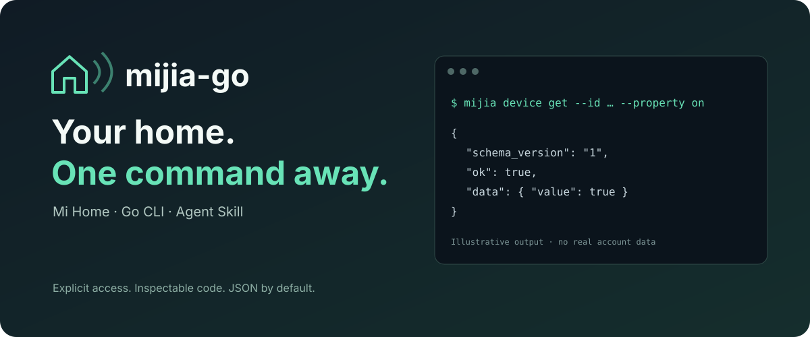

<p align="center">
  
</p>

<p align="center">
  <a href="https://github.com/Lewin671/mijia-go/actions/workflows/ci.yml"></a>
  <a href="https://github.com/Lewin671/mijia-go/releases"></a>
  <a href="LICENSE"></a>
</p>

<p align="center"><b>English</b> · <a href="README.zh-CN.md">简体中文</a></p>

# mijia-go

**Control Xiaomi / Mi Home devices from your terminal or your AI assistant.**

A small Go binary with a discoverable command surface, structured JSON, and a portable [Agent Skill](skills/mijia/SKILL.md). Query your devices, inspect their capabilities, change a property, or run an existing scene. No Python runtime. No MCP server. No background service.

> **Early preview.** The protocol and sign-in flow are tested with offline fixtures; real-account sign-in and physical-device behavior have **not yet been validated**. Currently targets the mainland-China Mi Home app cloud protocol. This is an independent community project, not an official Xiaomi product.

## A terminal for your home

```sh
mijia devices list
mijia device inspect --id DEVICE_ID
mijia device get --id DEVICE_ID --property on

# Preview first. No device write is sent.
mijia device set --id DEVICE_ID --property on --value true --dry-run

# You explicitly authorize this device once.
mijia policy allow-device --id DEVICE_ID
mijia device set --id DEVICE_ID --property on --value true
```

```json
{"schema_version":"1","ok":true,"data":{"accepted":true,"code":0,"requested":true,"actual":true,"verified":true}}
```

*Illustrative output, not a captured hardware test. Property names and modes vary by model; always inspect first.*

## Why this exists

- **For people:** one executable, QR sign-in, readable help, explicit device IDs, and previews before writes.
- **For agents:** JSON by default, an offline `schema` command, stable error codes, capability discovery, and a focused Skill.
- **For trust:** inspectable source, no telemetry or auto-updater, bounded HTTPS requests, private credential files, and writes denied until allowlisted.
- **For actual outcomes:** property writes distinguish cloud acceptance from observed state. A timeout never causes a write to be replayed automatically.

The CLI is a cloud client. It is **not** offline device control. See exactly [what leaves your machine](docs/security.md#network-and-data-flow).

## Install

With Go 1.26 or newer:

```sh
go install github.com/Lewin671/mijia-go/cmd/mijia@latest
mijia version
```

Or get a binary from [Releases](https://github.com/Lewin671/mijia-go/releases). Download the archive for your OS/CPU and verify it against the release's `checksums.txt` before extracting. Release builds target macOS, Linux, and Windows on amd64 and arm64; cross-compilation is not a claim of live-hardware compatibility.

For source review and a fixed checkout:

```sh
git clone https://github.com/Lewin671/mijia-go.git
cd mijia-go
go test ./...
go build -trimpath -o bin/mijia ./cmd/mijia
./bin/mijia help
```

## Get started

1. Run `mijia auth login` in your own terminal; scan the QR with the **Mi Home app**. The QR appears on stderr; stdout remains machine-readable. Do not share the QR or login files.
2. Run `mijia devices list`, then `mijia device inspect --id DEVICE_ID` to discover valid properties, values, and actions.
3. Use `--dry-run` to preview a change. When ready, allow that exact ID with `mijia policy allow-device --id DEVICE_ID`.
4. Send a write. For readable properties, the default verification checks the resulting state. `accepted: true` alone does not mean the physical device changed.

Reads do not require a device allowlist. Scene execution uses a **separate** scene allowlist because a scene can affect several devices. The local policy does not reduce the permissions of the underlying Xiaomi account.

## Give your AI the skill

```sh
npx skills add Lewin671/mijia-go --skill mijia
```

Install the CLI separately. Then ask your agent, for example:

> “Use the mijia skill to check my air purifier. Inspect its modes before changing anything.”

The [Skill](skills/mijia/SKILL.md) teaches discovery, exact-ID targeting, preview, authorization, and verification. It does not read credential files or grant itself device access. You can also copy `skills/mijia/` into your agent's supported skill directory.

## Useful commands

| Task | Command |
|---|---|
| Offline sign-in status | `mijia auth status` |
| Discover commands | `mijia schema` |
| Inspect device capabilities | `mijia device inspect --id ID` |
| Read an ambiguous property | `mijia device get --id ID --property 2.1` |
| Preview an action | `mijia device action --id ID --action ACTION --input '[]' --dry-run` |
| List manual scenes | `mijia scenes list` |
| Authorize a scene | `mijia policy allow-scene --id SCENE_ID` |
| Run that scene | `mijia scene run --id SCENE_ID --home HOME_ID` |
| Block all cloud writes | `mijia policy read-only` |
| Remove a device authorization | `mijia policy remove-device --id ID` |
| Remove local credentials | `mijia auth logout` |
| Offline diagnostics | `mijia doctor` |

Global flags go **before** the command: `mijia --human devices list`. Values are JSON: `true`, `50`, or `'"auto"'`. See the [CLI contract](docs/cli.md) for flags, output, exit codes, and outcome semantics.

## Scope and compatibility

- Supported in code: QR sign-in, credential refresh, home device discovery, MIoT specification discovery, property reads/writes, device actions, and existing manual scenes.
- Discovery currently follows devices returned by selected account homes; some shared/virtual devices may not be returned.
- Not included: creating Mi Home automations, video streaming, local LAN control, non-China cloud regions, or a daemon.
- No device model is marked hardware-verified yet. Help build an honest [compatibility matrix](docs/compatibility.md).

## Build with us

Good first contributions: a redacted compatibility report, a synthetic regression fixture, clearer sign-in diagnostics, or a tested platform improvement. Start with [CONTRIBUTING.md](CONTRIBUTING.md). Please report security problems through [SECURITY.md](SECURITY.md), without posting credentials or private device details.

If this is the kind of tool you want for your home, a star helps others find it. Compatibility reports and small fixes help it become dependable.

## Credits and license

Protocol behavior was studied from [Do1e/mijia-api](https://github.com/Do1e/mijia-api), including its Xiaomi cloud sign-in/request flow, and the credited micloud protocol work. This Go implementation is licensed **GPL-3.0-or-later**. QR encoding uses `skip2/go-qrcode` under MIT. See [LICENSE](LICENSE) and [THIRD_PARTY_NOTICES.md](THIRD_PARTY_NOTICES.md).
