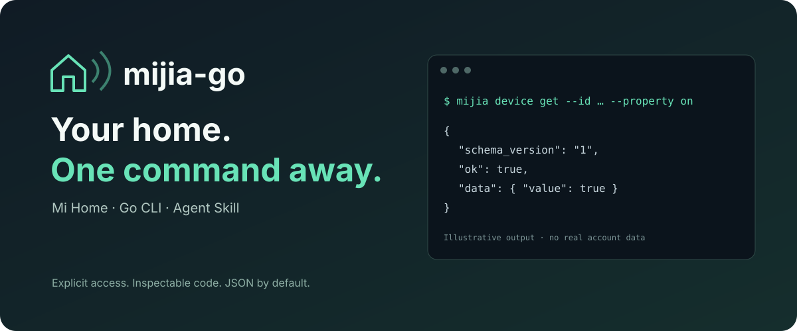

<p align="center"></p>

<p align="center"><a href="README.md">English</a> · <b>简体中文</b></p>

# mijia-go

**通过终端或 AI 助手控制米家设备。一个 Go 二进制，一个 Skill。**

查询设备、发现型号支持的属性、调整参数、执行已有手动场景。默认 JSON 输出，无需 Python、MCP 或常驻服务。

> **早期预览版。** 已通过离线模拟测试，尚未完成真实账号登录和实物设备验证。目前实现中国大陆米家 App 的云端协议；不代表所有米家型号或地区均可使用。这是独立社区项目，与小米官方无隶属关系。

## 安装

需要 Go 1.26 或更新版本：

```sh
go install github.com/Lewin671/mijia-go/cmd/mijia@latest
```

也可以下载 [Releases](https://github.com/Lewin671/mijia-go/releases) 中对应系统与架构的压缩包，先与 `checksums.txt` 核对，再解压使用。跨平台构建成功不等于对应平台已完成真机验证。

## 开始使用

```sh
# 在你自己的终端执行，用米家 App 扫码。不要分享二维码或认证文件。
mijia auth login

# 找到设备，再查看它实际支持哪些属性与取值。
mijia devices list
mijia device inspect --id DEVICE_ID
mijia device get --id DEVICE_ID --property on

# 预览不会发送写操作。
mijia device set --id DEVICE_ID --property on --value true --dry-run

# 由你明确授权这个设备后，才能发送写操作。
mijia policy allow-device --id DEVICE_ID
mijia device set --id DEVICE_ID --property on --value true
```

默认返回带 `schema_version`、`ok`、`data` 或 `error` 的 JSON。`--human` 可以格式化输出，放在命令之前：`mijia --human devices list`。`--value` 是 JSON，例如 `true`、`50` 或 `'"auto"'`，不要猜测设备的模式值。

属性写入会区分“云端已接收”和“回读已确认”。回读失败时，不会重复发送控制指令。动作与场景只报告接收情况，不冒充实物验证成功。

## 给 AI 安装 Skill

```sh
npx skills add Lewin671/mijia-go --skill mijia
```

CLI 需要单独安装。之后可以说：“用 mijia skill 查看净化器状态，先检查它支持的模式。”Skill 会指导 AI 发现设备、按精确 ID 操作、预览和检查结果，不读取凭据文件，也不会自行扩大白名单。也可把仓库的 `skills/mijia/` 复制到你的 AI 支持的技能目录。

## 权限与隐私

- 写操作默认拒绝；设备、场景分别授权。场景可能联动多台设备，不受设备白名单限制。
- `mijia policy read-only` 禁止全部设备/场景写操作；`--enabled=false` 解除只读覆盖。
- `mijia auth logout` 仅删除本机凭据，不代表撤销小米侧会话。
- macOS/Linux 认证目录使用 0700、文件使用 0600；令牌不会进入 CLI 输出。Windows 使用用户配置目录，ACL 仍需要自行确认。
- 这是云端客户端。请求会到小米登录、米家 API 和公开设备规格服务，不能离线操作。AI 会话会看到你查询的设备名称及状态。
- 当前不包含自动化创建、摄像头视频、LAN 本地控制、非大陆地区和后台服务。

更多信息：[CLI 约定](docs/cli.md) · [安全与数据流](docs/security.md) · [兼容性记录](docs/compatibility.md) · [贡献指南](CONTRIBUTING.md)。

欢迎提交脱敏后的兼容性报告和修复。如果它对你有用，点一个 Star，让更多米家玩家发现它。

## 致谢与许可

协议行为参考 [Do1e/mijia-api](https://github.com/Do1e/mijia-api) 和其致谢的 micloud 工作。Go 实现以 **GPL-3.0-or-later** 发布；二维码编码库采用 MIT。详见 [LICENSE](LICENSE) 和 [第三方声明](THIRD_PARTY_NOTICES.md)。
